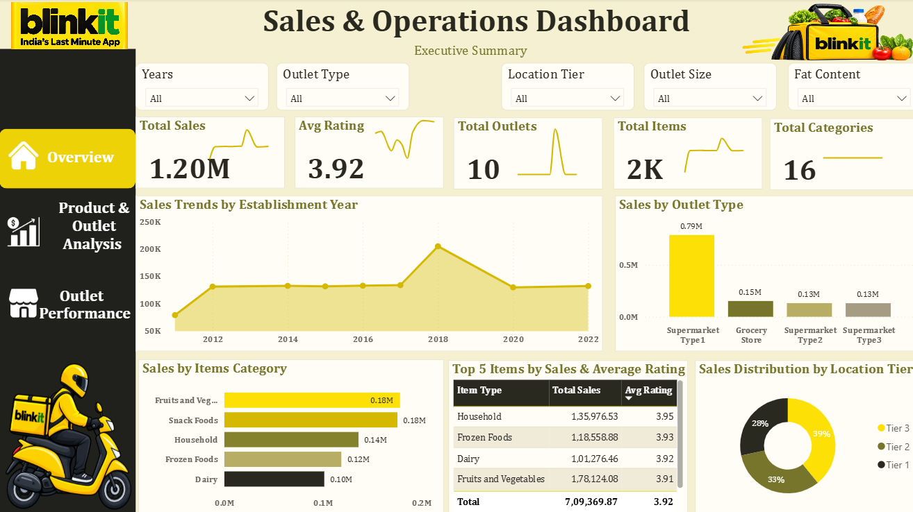

# 🛒 Blinkit Sales & Operations Dashboard

**Interactive Business Intelligence Dashboard \| Power BI • DAX • Data
Visualization**

An interactive Power BI project analyzing Blinkit's sales, product
categories, and outlet performance through KPI cards, sales trends,
category comparisons, outlet-size analysis, ratings, and location-tier
distribution.

------------------------------------------------------------------------

## 📌 Project Overview

This project uses Microsoft Power BI to explore grocery sales and outlet
performance through an interactive three-page dashboard.

The report helps explore questions such as:

-   💰 What are the overall sales and average ratings?
-   🏪 How do outlets compare by type, size, and identifier?
-   🥦 Which item categories contribute the most sales?
-   ⭐ How do ratings vary across outlet types?
-   📍 How are sales distributed across location tiers?
-   🥛 How does sales performance vary by fat content?
-   👁️ What is the relationship between item visibility and sales?

## 🖥️ Dashboard Pages

### 1️⃣ Overview

**Objective:** Summarize overall sales and outlet performance.

-   Total Sales
-   Average Rating
-   Total Outlets
-   Total Items
-   Total Categories
-   Sales trends by outlet establishment year
-   Sales by outlet type and item category
-   Top items by sales and average rating
-   Sales distribution by location tier

### 2️⃣ Product & Outlet Analysis

**Objective:** Explore product attributes and compare sales across
outlet characteristics.

-   Sales versus item visibility
-   Sales by outlet size
-   Sales by item type
-   Sales versus rating
-   Sales distribution by fat content
-   Filters for year/date, outlet type, location tier, outlet size, and
    fat content

### 3️⃣ Outlet Performance

**Objective:** Compare outlet-level sales, ratings, visibility, and item
counts.

-   Sales by outlet establishment year
-   Average rating by outlet type
-   Top outlets by total sales
-   Outlet performance summary table
-   Comparison of average rating, average sales, total sales, total
    items, and average visibility

## 📊 Key KPIs

  KPI                          Description
  ---------------------------- ----------------------------------------------
  💰 Total Sales               Total sales value under the selected filters
  ⭐ Average Rating            Average rating across the selected records
  🏪 Total Outlets             Number of distinct outlets
  🛍️ Total Items               Item count according to the report's measure
  🗂️ Total Categories          Number of distinct item categories
  👁️ Average Item Visibility   Average item visibility value
  ⚖️ Average Item Weight       Average item weight

*Values can change when slicers are applied.*

## 🗂️ Dataset

The project folder contains two dataset files:

-   `BlinkIT-Grocery-Data_Clean.xlsx` --- cleaned dataset
-   `BlinkIT-Grocery-Data_Raw.csv` --- raw dataset

The report uses fields related to item type, item weight, item
visibility, fat content, sales, ratings, outlet identifier, outlet
establishment year, outlet size, location tier, and outlet type. Exact
field names may differ in the Power BI model.

## 📐 DAX Measures

The following are example measures based on the fields used in the
dashboard. Replace `BlinkIT` with the exact table name in your Power BI
model if needed.

### 💰 Total Sales

``` dax
Total Sales =
SUM ( BlinkIT[Sales] )
```

### ⭐ Average Rating

``` dax
AVG RATING =
AVERAGE ( BlinkIT[Rating] )
```

### 🏪 Total Outlets

``` dax
TOTAL OUTLETS =
DISTINCTCOUNT ( BlinkIT[Outlet Identifier] )
```

### 🛍️ Total Items

If the measure is intended to count rows:

``` dax
TOTAL ITEMS =
COUNTROWS ( BlinkIT )
```

### 🗂️ Total Categories

``` dax
TOTAL CATEGORIES =
DISTINCTCOUNT ( BlinkIT[Item Type] )
```

### 👁️ Average Visibility

``` dax
AVG VISIBILITY =
AVERAGE ( BlinkIT[Item Visibility] )
```

### ⚖️ Average Item Weight

``` dax
AVG ITEM WEIGHT =
AVERAGE ( BlinkIT[Item Weight] )
```

### 💵 Average Sales

``` dax
AVG SALES =
AVERAGE ( BlinkIT[Sales] )
```

**Note:** Confirm the exact table and column names in your Power BI
model before using these examples. The correct definition of
`TOTAL ITEMS` depends on whether you want to count rows or unique
products.

## 🎨 Dashboard Design

The dashboard uses a Blinkit-inspired yellow, cream, olive, and charcoal
palette.

  Element                   Color
  ------------------------- -----------
  Primary yellow            `#FCE006`
  Cream background          `#F5F0D1`
  Chart/card background     `#FFFDF5`
  Charcoal text / sidebar   `#29291F`
  Olive accent              `#77752B`
  Muted gold                `#B7AD64`
  Borders / gridlines       `#E8E2C9`

Yellow highlights important KPIs and active navigation. Cream and
off-white provide contrast, while charcoal and olive support readable
labels and secondary chart elements.

## 📊 Visualizations

-   **KPI cards:** Sales, rating, outlets, items, and categories
-   **Line chart:** Sales by outlet establishment year
-   **Bar / column charts:** Sales by outlet type, item category, outlet
    size, and outlet identifier
-   **Donut charts:** Sales distribution by location tier and fat
    content
-   **Scatter plots:** Sales versus item visibility and rating
-   **Table / matrix:** Outlet-level performance comparison
-   **Slicers:** Year/date, outlet type, location tier, outlet size, and
    fat content

## 🔄 Analytics Workflow

1.  Load the raw grocery dataset.
2.  Review and clean data in Power Query / Excel.
3.  Check column names and data types.
4.  Create DAX measures for sales, ratings, outlets, items, and
    categories.
5.  Build KPI cards and interactive visuals.
6.  Apply consistent styling across all three pages.
7.  Test slicers and cross-filtering.
8.  Validate totals and labels before publishing.

## 💡 Analysis Opportunities

-   **Sales performance:** Compare sales across outlet types, sizes, and
    establishment years.
-   **Product categories:** Identify categories with higher and lower
    sales.
-   **Outlet comparison:** Compare outlets by sales, ratings, and item
    counts.
-   **Rating patterns:** Review ratings by outlet type and compare
    ratings with sales.
-   **Product visibility:** Explore the relationship between item
    visibility and sales.
-   **Location distribution:** Compare sales across location tiers.
-   **Fat content:** Compare sales distribution between fat-content
    groups.

These are analysis opportunities supported by the report. Conclusions
should be drawn from the actual data and selected filters.

## 🛠️ Tech Stack

  Area                        Technology
  --------------------------- --------------------
  Data visualization          Microsoft Power BI
  Data transformation         Power Query
  Measures and calculations   DAX
  Data preparation            Excel / CSV
  Dashboard design            Power BI

## 📚 Skills Demonstrated

-   Power BI report development
-   DAX measure creation
-   Data cleaning and transformation
-   KPI design
-   Data visualization
-   Sales and outlet performance analysis
-   Interactive slicers and cross-filtering
-   Dashboard design and visual consistency
-   Business-focused data storytelling

## 📁 Project Structure

``` text
Blinkit-Sales-Operations-Dashboard/
│
├── Datasets/
│   ├── BlinkIT-Grocery-Data_Clean.xlsx
│   └── BlinkIT-Grocery-Data_Raw.csv
│
├── Images/
│   ├── Delivery.png
│   ├── Home.png
│   ├── Logo.jpg
│   ├── Outlet.png
│   ├── Profit.png
│   ├── Store.png
│   └── Store_Shares.png
│
├── Screenshots/
│   ├── Outlet Performance.png
│   ├── Overview.png
│   └── Product & Outlet Analysis.png
│
├── Blinkit_Analysis.pbix
└── README.md
```

## 📸 Dashboard Preview

The following screenshots are included in the `Screenshots/` folder.

### 🏠 Overview



### 🛍️ Product & Outlet Analysis


### 🏪 Outlet Performance


## 🚀 How to Use

1.  Download or clone this repository.
2.  Open `Blinkit_Analysis.pbix` in Microsoft Power BI Desktop.
3.  If prompted, update the data-source path to the dataset location on
    your computer.
4.  Refresh the report and interact with the slicers and visuals.

## 🎯 Project Outcome

This project demonstrates how a grocery sales dataset can be transformed
into an interactive Power BI report for exploring sales, product
categories, ratings, and outlet performance. It showcases practical
dashboard development, DAX calculations, and business-oriented visual
storytelling.

## 👩‍💻 Author

**Chanchal Khandkure**\
Aspiring Data Analyst

**Skills:** Power BI • SQL • Python • Excel • Data Analysis • Data
Visualization

-   GitHub: [Chanchal2011](https://github.com/Chanchal2011)
-   LinkedIn: [Chanchal
    Khandkure](https://www.linkedin.com/in/chanchal-khandkure)

------------------------------------------------------------------------

⭐ If you find this project useful, feel free to explore the report and
share feedback.
